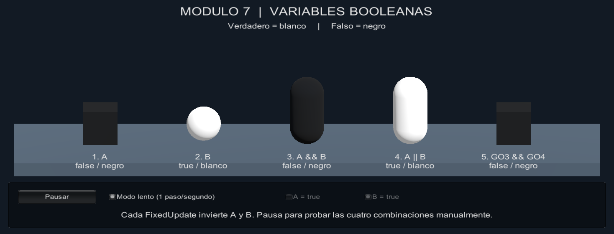
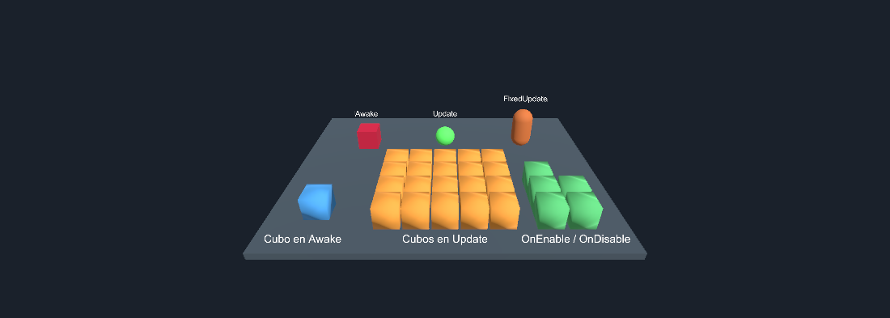

# shg — Prácticas de Unity

Proyecto para Unity **2022.3.62f3**. La actividad actual está en la rama `Practica-Modulo-8`.

## Módulo 8: variables numéricas y cadenas

Abre `Assets/Modulo 8/Modulo8.unity`, pulsa **Play** y filtra la consola por `[M8`. Los mensajes numerados corresponden a los ejercicios de las dos partes. Las primeras muestras de `Update` y `FixedUpdate` aparecen en la consola, y los valores siguen cambiando en el Inspector.

Selecciona **Cubo de paridad** para ver el componente **Ejercicios Variables Mod 8**. El cubo alterna entre magenta (impar) y cian (par). Cambia **Palabra Color** a `rojo`, `verde` o `azul` durante Play para cambiar el segundo cubo. Escribe tu nombre en **Nombre Completo** antes de pulsar Play para ver su separación con `Substring` y `Split`.

## Módulo 7: variables booleanas, AND y OR

Abre `Assets/Modulo 7/Modulo7.unity` y pulsa **Play**. Hay cinco objetos en fila: A, B, `A && B`, `A || B` y `GO3 && GO4`. Cada uno se muestra blanco si su valor es `true`, negro si es `false`.

Los dos primeros invierten su booleano en cada `FixedUpdate`. El **Modo lento** permite observar los cambios. Pulsa **Pausar** y cambia las casillas **A = true** y **B = true** para probar las cuatro combinaciones. Los tres resultados se recalculan al cambiar una entrada.

Los scripts están en `Assets/Modulo 7/Script` y los cinco prefabs en `Assets/Modulo 7/Prefab`. Son adaptaciones independientes de la práctica anterior: las tres líneas de color aleatorio están comentadas en las copias del módulo 7. Los módulos 5 y 6 siguen disponibles en sus escenas.

La [guía del módulo 7](Docs/Modulo7.md) relaciona cada paso con su implementación e incluye la tabla de verdad. Para repetir la verificación utiliza **Practicas > Modulo 7 > Comprobar en Play** con la escena guardada y Play detenido.

## Módulo 6: colores y creación de cubos

Abre `Assets/Módulo 6/Modulo6.unity` y pulsa **Play**. Los scripts están en `Assets/Módulo 6/Script` y los tres prefabs en `Assets/Módulo 6/Prefab`.

| Objeto | Script | Comportamiento |
| --- | --- | --- |
| Cube1 | FristGO | Color aleatorio en `Awake`, una vez por instancia. |
| Sphere1 | SecondGO | Color aleatorio en cada `Update`. |
| Capsule1 | ThirthGO | Color aleatorio en cada `FixedUpdate`. |
| Generador_Awake | CrearCuboAwake | Construye un cubo al cargarse. |
| Generador_Update | CrearCubosUpdate | Construye un cubo por fotograma hasta el máximo de 20, ajustable en el Inspector. |
| Generador_OnEnable_OnDisable | CrearCuboActivacion | Construye un cubo cada vez que se activa o desactiva durante Play. |

Los cubos de la segunda parte se construyen con una malla de ocho vértices y doce triángulos, MeshRenderer y BoxCollider. En la primera parte se usa `Random.value`: en Unity es una propiedad, se escribe en minúscula y sin paréntesis.

Para probar la activación, selecciona **Generador_OnEnable_OnDisable** durante Play y desmarca y marca su casilla de activo. Los cubos quedan en **Cubos generados** y siguen visibles. Al detener Play no se generan cubos adicionales.

La escena incluye etiquetas para distinguir cada ejercicio. La guía completa y los pasos de entrega están en [Docs/Modulo6.md](Docs/Modulo6.md). El menú **Practicas > Modulo 6 > Comprobar en Play** permite repetir las comprobaciones de comportamiento.

## Módulo 5: Hola Mundo

Proyecto de Unity 2022.3.62f3 para practicar el ciclo de vida de un componente y los mensajes de la consola.

## Ejecución

1. Abre el proyecto con Unity 2022.3.62f3.
2. Abre `Assets/Scenes/SampleScene.unity`.
3. Selecciona **Main Camera**: tiene añadido el componente **Hola Mundo** (`Assets/Scripts/HolaMundo.cs`).
4. Abre **Window > General > Console**, activa los filtros de mensajes, advertencias y errores y pulsa **Play**.

| Función | Cuándo se ejecuta | Mensaje de consola |
| --- | --- | --- |
| `Awake` | Al cargar la instancia del componente, antes de `Start`. | `Debug.Log` |
| `Start` | Una vez, antes del primer `Update` del componente. | `Debug.LogWarning` |
| `Update` | En cada fotograma mientras el componente está activo. | `Debug.LogError` en su primera ejecución. |

El mensaje rojo es intencionado y forma parte del ejercicio: no es una excepción ni un error de compilación. Un booleano permite que `Update` siga ejecutándose cada fotograma y que su mensaje aparezca solo una vez por ejecución. Si **Error Pause** está activado, Unity puede pausar al mostrarlo; puedes continuar o detener Play.

El archivo y la clase se llaman `HolaMundo`, sin espacio, para que Unity pueda reconocer y añadir el componente. El Inspector lo muestra como **Hola Mundo**.

## Entrega

La práctica se prepara en la rama `Practica-Modulo-5`, con un Pull Request hacia `main`. El enlace del repositorio y el del Pull Request permiten revisar el código, la escena y los cambios.
